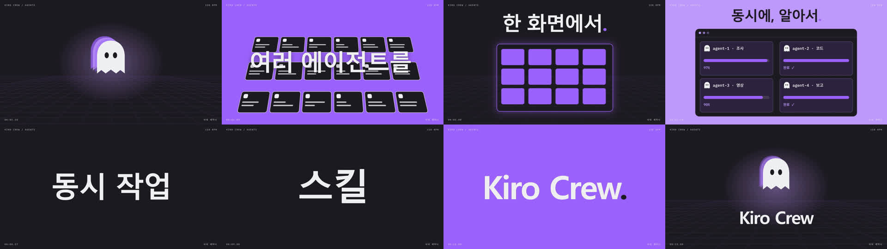
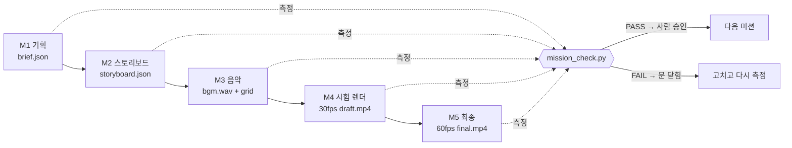
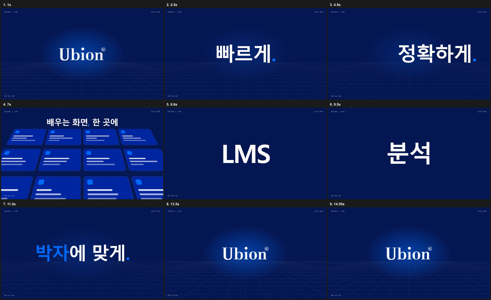
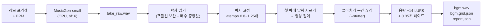

# video-mission — AI-DLC로 만드는 홍보영상 제작 도구

> 짧고 빠른 홍보영상을 **AI-DLC 5단계 미션**으로 만듭니다.
> 단계마다 숫자로 재고, 기준을 못 넘으면 다음 단계로 가지 않습니다.
> 배경음악은 PC에서 돌리는 **MusicGen**으로 만들고, 컷을 음악 박자에 맞춥니다.

*A promo-video production kit built as an [AI-DLC](https://github.com/awslabs/aidlc-workflows) plugin:
five gated missions (brief → storyboard → music → draft → final), each measured by a script,
with beat-locked background music from MusicGen running on a CPU-only PC.*

[](docs/media/kirocrew-promo.mp4)

<sub>이 도구로 만든 15초 영상 「Kiro Crew 사내 세미나 오프닝」. 128 BPM, 초당 컷 0.73, 계획한 컷 100% 일치.
**▶ 이미지를 누르면 영상이 열립니다** (소리 있음).</sub>

### ▶ 영상 보기

| 영상 | 파일 | 길이 · 형식 |
|---|---|---|
| Kiro Crew 사내 세미나 오프닝 (최종) | [▶ kirocrew-promo.mp4](docs/media/kirocrew-promo.mp4) | 15초 · 1920x1080 · 60fps · 4.8 MB |
| ubion-fast-test 파이프라인 시험 (M4 초안) | [▶ ubion-fast-test-draft.mp4](docs/media/ubion-fast-test-draft.mp4) | 15초 · 1920x1080 · 30fps · 5.2 MB |

<sub>링크를 누르면 GitHub 파일 화면에서 바로 재생됩니다. 배경음은 둘 다 ffmpeg로 직접 만든 128 BPM 합성 비트입니다.</sub>

---

## 왜 만들었나

AI에게 "빠른 홍보영상 만들어줘"라고 하면 매번 결과가 다르고, **잘 됐는지 말로만** 판단합니다.
이 도구는 영상 제작을 소프트웨어처럼 다룹니다.

| 문제 | 이 도구의 답 |
|---|---|
| "빠르다"가 사람마다 다름 | 템플릿 30개를 실제로 재서 정한 기준 (장면 1.5~2.5초, 몰아치기 5~9컷, 초당 컷 0.6~0.8) |
| 단계를 건너뜀 | AI-DLC 단계 + 승인 문. 측정 센서가 **차단(blocking)** 이라 기준 미달이면 문이 안 열림 |
| 음악과 컷이 따로 놂 | 음악을 정확한 BPM으로 고정하고 박자 그리드(JSON)를 만들어 컷을 그 위에 놓음 |
| 무엇을 했는지 남지 않음 | 단계마다 요약(`video-mission-<단계>.md`)·측정 JSON·관찰 일지가 남음 |
| 진행이 안 보임 | 영상별 탭이 있는 웹 대시보드 (자동 갱신) |

---

## 한눈에 보기



| 미션 | 하는 일 | 자동 측정 (통과 기준) |
|---|---|---|
| **M1 기획** | 목적·대상·길이·비율·상업 여부·빠르기·문구를 한 번에 묻고, 브랜드 색·로고·글꼴 정리 | 필수 항목, 길이 5~28초, 비율, 브랜드 색 hex 2개 이상 |
| **M2 스토리보드** | 장면을 마디 단위로, 몰아치기(burst)를 55~75% 지점에 | 빈틈 ≤0.1초, 보통 장면 평균 1.5~2.5초, 몰아치기 5~9컷·0.2~0.4초 간격 |
| **M3 음악** | MusicGen(또는 대체 음원) → BPM 고정·음량 맞춤·박자 그리드 | 길이 ±0.05초, BPM ±2, −14 ±1 LUFS, 라이선스 |
| **M4 시험 렌더** | HyperFrames 템플릿 복사 → 30fps 초안 | 초당 컷 0.6~0.8, 몰아치기 위치, **계획한 컷의 80%가 ±0.1초 안**, **잰 컷의 80%가 8분음표 ±0.05초 안** |
| **M5 최종** | 60fps 렌더, 업로드 형식 확인, 배운 점 기록 | 60fps, 1920x1080, H.264 + yuv420p, M4와 같은 리듬 |

단계별 요구사항 전체: [`docs/missions/`](docs/missions/) (원본 [`docs/missions.json`](docs/missions.json)) · 규격: [`docs/PROCESS_SPEC.md`](docs/PROCESS_SPEC.md)

---

## 실제로 만든 영상 2개

| 영상 | 내용 | 결과 |
|---|---|---|
| `kirocrew-promo` | Kiro Crew 사내 세미나 오프닝, 15초 16:9, 기능 5개 몰아치기 | 5단계 모두 첫 측정 통과. 초당 컷 0.73 · 몰아치기 56% · 계획 컷 일치 1.0 · 박자 일치 1.0 |
| `ubion-fast-test` | 파이프라인 시험용 15초 키네틱 타이포 | M4 첫 초안 **실패**(초당 컷 0.53, 계획 일치 0.62) → 원인 찾아 고친 뒤 0.8 / 0.92로 통과 |

[](docs/media/ubion-fast-test-draft.mp4)

두 영상의 단계 기록이 그대로 들어 있습니다: [`aidlc/spaces/default/intents/`](aidlc/spaces/default/intents/)
(요약 · 측정 JSON · 관찰 일지 `memory.md` · 질문지). 실패에서 배운 점은 이렇습니다.

> **같은 배경 위에서 글자만 바뀌면 컷으로 잡히지 않는다.** 첫 초안은 남색 배경이 계속 남아 장면 점수가 0.05~0.08이었다(컷 기준 0.30).
> 장면마다 배경색을 바꾸자 모든 계획 컷이 잡혔다. 두 번째 영상은 처음부터 이렇게 설계해 첫 렌더에 통과했다.

---

## MusicGen 배경음악

영상 하나에 **가사 없는 배경음 하나**. MusicGen이 장르 프롬프트로 원본을 만들고,
가벼운 후처리가 박자를 정확히 맞춘 뒤 컷을 놓을 **박자 그리드**를 씁니다.
코드: [`companion/video-lab/skills/musicgen-trendy/`](companion/video-lab/skills/musicgen-trendy/) ·
전체 안내: [`SKILL.md`](companion/video-lab/skills/musicgen-trendy/SKILL.md)

### ⚠ 라이선스 먼저

| 쓰는 곳 | MusicGen |
|---|---|
| 사내용, 시험, 발표, 수익 없는 교육 | ✅ 사용 가능 |
| 광고, 고객 납품, 수익 채널, 회사 마케팅 | ❌ **사용 불가** |

`facebook/musicgen-*` **가중치는 CC BY-NC 4.0(비상업)** 입니다. 코드가 아니라 모델 가중치의 조건입니다.
그래서 M1에서 "상업용인가?"를 반드시 묻고, M3 측정(C3.5)이 상업 영상에 비상업 음원이 들어가면 **실패** 처리합니다.
상업 영상은 ACE-Step 1.5(MIT) 같은 다른 모델이나 라이선스 음원을 쓰세요. 이 저장소에는 **가중치가 들어 있지 않습니다.**

### 어떻게 동작하나



1. **생성** — 프리셋 프롬프트(+ BPM)를 `musicgen-small`에 넣습니다. GPU 없이 CPU에서, 15초에 1~3분.
2. **박자 읽기** — 원본의 실제 BPM을 잽니다. 1% 오차도 15초 끝에서 0.14초 밀리므로, 소수점까지 보간하고 1·2·4·8배 후보의 중앙값으로 정합니다 (128 BPM 합성음을 129.2 → 128.12로 바로잡음).
3. **박자 고정** — `ffmpeg atempo`로 목표 BPM에 맞춥니다. 늘림이 0.8~1.25배를 넘으면 소리가 상하므로 늘리지 않고 다시 만들라고 알립니다.
4. **첫 박 정렬 · 길이 자르기** — 파일이 다운비트에서 시작하고 영상 길이와 정확히 같게.
5. **끊김(stutter)** — 영상의 몰아치기 구간(55~75%)에서 16분음표 조각을 8분음표마다 반복해 음악도 같이 "몰아칩니다".
6. **마스터링** — −14 LUFS(소셜 표준), 끝 0.35초 페이드.
7. **박자 그리드** — `bgm.grid.json`: `bars`, `beats`, `eighths`, `scene_cuts_suggested`, `burst {start, end, eighths}` (초 단위). 스토리보드와 HyperFrames 타임라인이 이 값을 씁니다.

### 프리셋

| 영상 | 프리셋 | BPM | 1마디 / 8분음표 |
|---|---|---|---|
| 빠른 제품 출시, 키네틱 타입 (**기본**) | `minimal-techno` | 128 | 1.875초 / 0.234초 |
| 기능 나열 광고 | `hype-sports` | 125 | 1.92초 / 0.24초 |
| 로고 공개, 오프닝 | `trailer-hybrid` | 120 | 2.0초 / 0.25초 |
| 강한 소셜 몽타주 | `drift-phonk` | 140 | 1.71초 / 0.214초 |
| 라이프스타일 · 앱 | `uk-garage` | 132 | 1.82초 / 0.227초 |
| 따뜻한 브랜드 필름 | `afro-house` | 122 | 1.97초 / 0.246초 |
| 밝은 SaaS 데모 | `future-bass` | 120 | 2.0초 / 0.25초 |
| 레트로 네온 | `synthwave` | 110 | 2.18초 / 0.273초 |
| 설명 영상 (빠른 컷 아님) | `lofi-explainer` | 88 | 2.73초 / 0.341초 |

### 설치 (Windows, CPU)

```powershell
cd video-lab
py -3.11 -m venv tools\musicgen\.venv
tools\musicgen\.venv\Scripts\python -m pip install torch==2.15.0 --index-url https://download.pytorch.org/whl/cpu
tools\musicgen\.venv\Scripts\python -m pip install -r .claude\skills\musicgen-trendy\requirements.txt
# 가중치(오프라인 사용): Hugging Face facebook/musicgen-small → tools\musicgen\models\musicgen-small
# 없으면 첫 실행 때 내려받습니다. ffmpeg가 PATH에 있어야 합니다.
```

### 사용

```bash
PY=tools/musicgen/.venv/Scripts/python.exe
S=.claude/skills/musicgen-trendy/scripts/musicgen_bgm.py

$PY $S presets                                                        # 프리셋 목록
$PY $S all --preset minimal-techno --duration 15 --stutter \
       --out projects/<이름>/assets/bgm                               # 생성 + 후처리
$PY $S post --in projects/<이름>/assets/bgm/take_1_raw.wav \
       --bpm 128 --duration 15 --stutter --out projects/<이름>/assets/bgm   # 후처리만 (가벼움)
```

| 옵션 | 뜻 |
|---|---|
| `--duration 15` | 영상 길이(초). 최대 28초, `--long`이면 60초 |
| `--long` | 28초를 넘길 때: 앞 조각 끝 4초를 다음 조각의 소리 프롬프트로 넣어 24초씩 이어 만들고 20ms 크로스페이드로 붙임. 이음새는 `report.json → seams_s`, M3 측정(C3.6)이 이음새 앞뒤 음량 차 ≤3dB 확인 |
| `--takes 2` | 시드 두 개로 만들어 박자가 가장 또렷하고 BPM에 가까운 쪽을 고름 |
| `--seed 7` · `--cfg 3.0` · `--extra "darker"` | 다른 결과 · 프롬프트 충실도(2.5~4) · 프리셋에 단어 추가 |
| `--dtype bf16` (기본) | 가중치를 bfloat16으로 올려 상주 메모리 약 1.2GB (fp32는 2.4GB) |

### 메모리가 작은 PC에서 (7.7GB RAM, GPU 없음에서 시험)

- 스크립트는 모델을 올리기 전 **빈 메모리 2.5GB**, 올린 뒤 **1.9GB** 를 확인하고, 모자라면 **생성 전에 멈춥니다** (시스템이 멈추지 않게).
- 생성은 **혼자** 돌립니다 — 렌더·다른 무거운 작업과 동시에 하지 않습니다.
- 실제로 겪은 일: 브라우저·메신저가 켜진 상태에서 모델을 올리자 빈 메모리가 1.6GB로 떨어져 안전장치가 멈췄습니다. PC 재시작 직후처럼 3GB 이상 비어 있을 때 쓰세요.

### MusicGen을 못 쓸 때: 합성 비트 대체

메모리가 모자라거나 빨리 확인만 하고 싶을 때, `ffmpeg`만으로 **정확한 BPM의 비트**를 만들고 같은 후처리(`post`)를 거칩니다. 두 시험 영상 모두 이 방법을 썼습니다.

```bash
B=0.46875   # 128 BPM 한 박
KICK="0.9*sin(2*PI*(45+140*exp(-40*mod(t,$B)))*mod(t,$B))*exp(-9*mod(t,$B))"
HAT="0.16*(random(0)*2-1)*exp(-90*mod(t+$B/2,$B))"
BASS="0.30*sin(2*PI*(49*if(lt(mod(t,8*$B),4*$B),1,1.335))*t)*(1-exp(-25*mod(t+$B/2,$B)))*exp(-3*mod(t+$B/2,$B))"
ARP="0.08*sin(2*PI*(392*if(lt(mod(t,$B),$B/2),1,1.5))*t)*exp(-18*mod(t,$B/2))*gte(t,4*$B)"
ffmpeg -f lavfi -i "aevalsrc='$KICK+$HAT+$BASS+$ARP':s=44100:d=17" -ac 2 take_synth_raw.wav
$PY $S post --in take_synth_raw.wav --bpm 128 --duration 15 --stutter --out projects/<이름>/assets/bgm
```

> 주의: 2·4박에 박수(clap)를 넣으면 박자 읽기가 85 BPM(2/3배)으로 틀립니다. 킥·하이햇·베이스·아르페지오만 쓰세요.
> 출처는 `report.json`의 `source`·`license`에 적습니다(`self-made`). 상업 영상에도 쓸 수 있습니다.

### 문제 해결

| 증상 | 해결 |
|---|---|
| `STOP: 빈 메모리 …` | 무거운 앱을 닫거나 기다림. `--min-free-gb`를 2.0 아래로 낮추지 말 것 |
| 소리가 탁하고 산만함 | 새 `--seed`, `--cfg 3.5`, 악기 수를 줄인 프롬프트 |
| 컷과 박자가 어긋남 | 원본이 늘림 범위(0.8~1.25) 밖 → 새 시드 또는 `--takes 2` |
| `stretch_ratio`가 1.0인데 BPM이 다름 | 박자 읽기가 배수로 틀림(예: 박수) → 원본을 바꿔 다시 |
| 너무 작거나 큼 | 파일은 −14 LUFS로 고정. 영상 구성에서 볼륨을 조절 |

---

## 웹 대시보드

```powershell
python scripts/mission_dashboard.py --serve      # http://127.0.0.1:8765  (로컬에서만 열림)
python scripts/mission_dashboard.py              # 정적 dashboard/index.html + DASHBOARD.md
python scripts/mission_dashboard.py --demo       # 예시 데이터
```

- **영상마다 탭**, 그리고 모든 영상을 한 표로 보는 **전체** 탭. 탭은 주소 `#<기록 이름>`에 남아 새로고침해도 그대로입니다.
- 영상 탭: 상태(완료 / 진행 중 / 멈춤), brief 조건과 색, `final.mp4`(없으면 `draft.mp4`) 재생, 장면 모음, M1~M5 카드(판정, 미달 항목, 요구사항 펼치기).
- **자동 갱신**: `--serve`는 5초마다 `/stamp`를 확인해 기록이나 영상이 바뀌면 다시 읽습니다(영상 재생 중엔 기다림).
  `mission_check.py`는 측정할 때마다 정적 대시보드도 다시 만듭니다.
- 영상 파일은 등록된 프로젝트의 `final.mp4` · `draft.mp4` · 장면 모음만 열립니다.
- VS Code 확장 **AIDLC-VIEWER**(`jikjeong.aidlc-viewer`)로 이 폴더를 열면 AI-DLC 단계 진행도 보입니다.

---

## 설치와 사용

### 필요한 것

| 무엇 | 버전 / 비고 |
|---|---|
| [AI-DLC](https://github.com/awslabs/aidlc-workflows) | 2.11.4에서 시험. `.claude/` 셸은 이 저장소에 없음 — 설치 후 생성 |
| Claude Code | AI-DLC 하네스 |
| [HyperFrames](https://www.npmjs.com/package/hyperframes) | `npx hyperframes@0.8.96` (한 프로젝트에서 버전을 섞지 않음) |
| 영상 템플릿 | `opus-5-5-video-templates` 스킬의 템플릿 30개 (이 저장소에 없음) |
| Python 3.11, ffmpeg | 측정·대시보드·음악 후처리 |
| MusicGen | 선택. 위 「설치」 참고 |

### 폴더 두 개

```
workspace/
├── video-lab-tools/   ← 이 저장소: AI-DLC 기록·플러그인·대시보드
└── video-lab/         ← 영상 작업 폴더: 템플릿, 스킬, projects/<영상>/   (companion/video-lab 참고)
```

AI-DLC는 훅·권한·규칙을 많이 넣기 때문에, 영상 작업 폴더와 **분리**했습니다(충돌 시험 결과).
기록과 판정은 여기에, 실제 영상 파일은 `video-lab/projects/<이름>/`에 둡니다.

### 시작

```powershell
cd video-lab-tools
aidlc config --harness claude
aidlc engine plugin build claude build\video-mission          # plugins\video-mission 폴더에서
aidlc engine plugin sync --plugin-root <절대경로>\build\video-mission --yes
aidlc doctor
```

Claude Code에서:

```
/aidlc video-mission-video 15초 빠른 출시 영상
```

질문에 답하고(A/B/C 선택), 각 미션의 측정표를 보고 **승인**하면 다음 미션으로 갑니다.

### 플러그인 고치기

`plugins/video-mission/`(단계·센서·에이전트·지식·범위) → `aidlc engine plugin validate video-mission` → build → sync.
요구사항을 바꾸려면 `docs/missions.json`을 고치고 `python scripts/build_mission_docs.py`.

---

## 폴더 구조

```
plugins/video-mission/     AI-DLC 플러그인 원본 (5개 단계, 차단 센서, 감독 에이전트, 범위 video-mission-video)
build/video-mission/       빌드된 플러그인
docs/                      PROCESS_SPEC.md, missions.json, 단계별 요구사항 페이지
scripts/                   mission_dashboard.py, build_mission_docs.py
companion/video-lab/       영상 폴더 쪽 파일: mission_check.py, sample_speed.py, musicgen-trendy 스킬
aidlc/spaces/default/      AI-DLC 메모리·요약 템플릿 + 실제 영상 2개의 단계 기록
dashboard/, DASHBOARD.md   생성된 대시보드
```

## 한계

- 경로가 이 PC(Windows, `C:\Users\Administrator\.kiro\crew\workspace\…`)에 맞춰져 있습니다. 다른 PC에서는 플러그인 단계 파일과 `project.md` 규칙의 경로를 바꿔야 합니다.
- 영상 템플릿과 HyperFrames 구성 파일은 들어 있지 않습니다. 완성 영상은 예시 2개만 `docs/media/`에 있습니다.
- 측정은 "빠른 영상" 기준(`pace: fast`)에 맞춰져 있습니다. 설명 영상(`explainer`)은 기준만 있고 실제로는 아직 시험하지 않았습니다.
- 한글 글꼴은 로컬 맑은 고딕을 씁니다(Windows).

## 라이선스

- 이 저장소의 코드와 문서: [MIT](LICENSE)
- **MusicGen 가중치: CC BY-NC 4.0 (비상업)** — 포함되지 않으며, 쓰는 사람이 조건을 지켜야 합니다.
- AI-DLC, HyperFrames, 영상 템플릿은 각자의 라이선스를 따릅니다.
